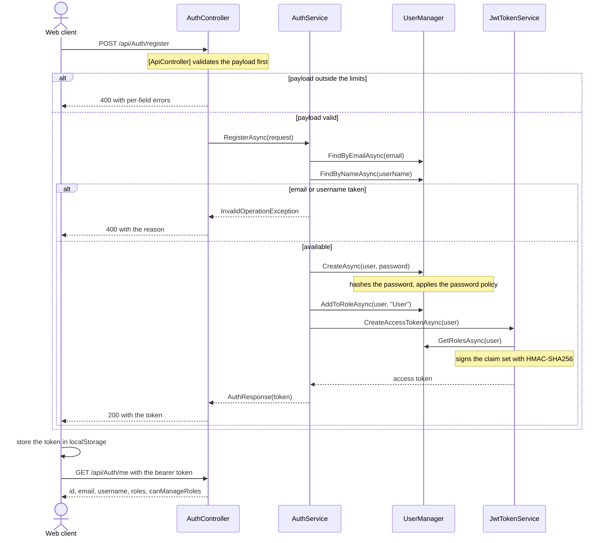
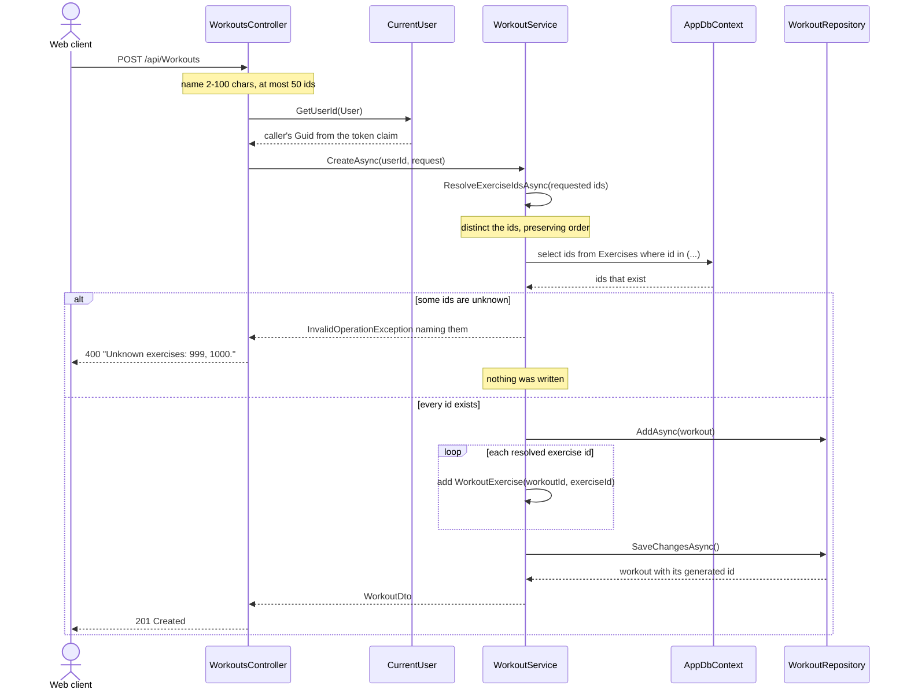
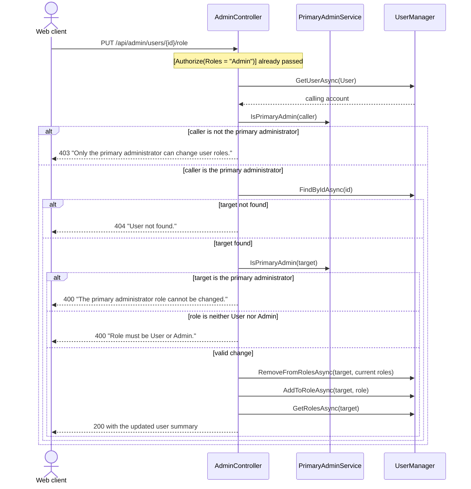

# Fit Ledger

A web application for tracking personal fitness activity. The system lets each user build workouts from a shared catalogue of exercises, set goals with optional target dates, and log progress measurements over time. Every piece of data a user creates is scoped to that user alone, while the exercise catalogue is curated centrally by administrators and visible to everybody, including visitors who are not logged in.

The project is split into two parts that are developed and deployed separately:
- **API** - an ASP.NET Core 8 Web API backed by PostgreSQL, exposing a JWT-secured REST interface and a Swagger UI
- **Web client** - a React 19 single-page application built with Vite, consuming that API

---

## API Endpoints

All 18 routes below are grouped by controller. "Anonymous" means no token is required, "User" means any authenticated account, and "Admin" means the token must carry the `Admin` role.

| # | Method | Route | Access | Description |
|---|---|---|---|---|
| 1 | POST | `/api/Auth/register` | Anonymous | Create an account, assign it the `User` role, and return an access token |
| 2 | POST | `/api/Auth/login` | Anonymous | Exchange email and password for an access token |
| 3 | GET | `/api/Auth/me` | User | Return the caller's id, email, username, roles, and whether they may manage roles |
| 4 | GET | `/api/Exercises` | Anonymous | List the full exercise catalogue, sorted by name |
| 5 | POST | `/api/Exercises` | Admin | Add a new exercise to the catalogue |
| 6 | DELETE | `/api/Exercises/{id}` | Admin | Remove an exercise, provided no workout still references it |
| 7 | GET | `/api/Workouts` | User | List the caller's workouts |
| 8 | GET | `/api/Workouts/{id}` | User | Fetch one of the caller's workouts with its exercise ids |
| 9 | POST | `/api/Workouts` | User | Create a workout and link the selected exercises |
| 10 | PUT | `/api/Workouts/{id}` | User | Rename a workout and replace its exercise selection |
| 11 | DELETE | `/api/Workouts/{id}` | User | Delete one of the caller's workouts |
| 12 | GET | `/api/Goals` | User | List the caller's goals |
| 13 | POST | `/api/Goals` | User | Create a goal with an optional description and target date |
| 14 | PATCH | `/api/Goals/{id}/complete` | User | Mark a goal complete or incomplete |
| 15 | GET | `/api/Progress` | User | List the caller's progress entries |
| 16 | POST | `/api/Progress` | User | Log a measurement as a metric name and a numeric value |
| 17 | GET | `/api/admin/users` | Admin | List every account with its role and primary-admin flag |
| 18 | PUT | `/api/admin/users/{id}/role` | Admin | Promote or demote an account, restricted to the primary administrator |

Ownership is enforced per request rather than per response: the controllers read the caller's id from the token through `CurrentUser.GetUserId()` and pass it into the service layer, so a workout, goal, or progress entry belonging to somebody else is indistinguishable from one that does not exist.

---

## Domain Model

### `AppUser`
Extends `IdentityUser<Guid>`, so identity, password hashing, and role membership are handled by ASP.NET Core Identity while the primary key is a `Guid` rather than the default `string`. Owns three collections - `Workouts`, `Goals`, and `ProgressEntries` - each configured with cascade delete, so removing an account removes everything that account created.

### `AppRole`
Extends `IdentityRole<Guid>`. Only two roles exist at runtime, both created by the seeder: `Admin` and `User`.

### `Workout`
A named training session belonging to one user. Holds a name (required, 200 characters at the database level), the owning `UserId`, and a collection of `WorkoutExercise` links.

### `Exercise`
A catalogue entry shared by every user. Holds a name that is required, capped at 200 characters, and covered by a **unique index**, so the same exercise cannot be registered twice. An exercise is not owned by anybody - it is created and deleted only by administrators.

### `WorkoutExercise`
The join entity between `Workout` and `Exercise`. Uses the composite key `(WorkoutId, ExerciseId)`, which makes the pairing unique by construction: the same exercise cannot be attached to the same workout twice, no matter how many times its id appears in the request.

### `Goal`
A personal objective belonging to one user. Holds a title (required, 200 characters), an optional description (500 characters), the creation timestamp, an optional target date, and a completion flag. `CreatedAtUtc` is stamped by the service rather than accepted from the client.

### `ProgressEntry`
A single measurement belonging to one user. Holds a date, a metric name (required, 100 characters) describing what was measured, and a `decimal` value.

### `Roles` _(static class)_
Holds the two role names as `const string` values, so controllers, the seeder, and the authorization attributes all reference the same literals instead of repeating them.

---

## Service Classes

### `AuthService`
_Handles registration and login, and is the only service that talks to Identity's `UserManager` and `SignInManager`._

**`RegisterAsync()`** is responsible for the following logic:
- trim the submitted username and email
- reject the request if the email is already registered
- reject the request if the username is already taken
- create the account through `UserManager`, letting Identity hash the password and enforce its password policy
- surface Identity's own failures by joining their descriptions into a single message
- assign the new account the `User` role
- issue an access token for the account and return it

**`LoginAsync()`** looks the account up by email and verifies the password through `CheckPasswordSignInAsync` with lockout disabled. A missing account and a wrong password both produce the same `Invalid credentials.` message, so the endpoint cannot be used to discover which emails are registered.

See the [authentication sequence diagram](#authentication---register-and-login) in Workflow Visualization.

---

### `JwtTokenService`
Builds the signed access token. Reads the issuer, audience, signing key, and lifetime from the bound `JwtOptions`, collects the account's roles through `UserManager`, and assembles the claim set:

| Claim | Value |
|---|---|
| `sub` / `NameIdentifier` | the account's `Guid` |
| `email` / `Email` | the account's email |
| `jti` | a fresh `Guid` per token |
| `Role` | one claim per role held by the account |

The token is signed with **HMAC-SHA256** over the key from configuration and expires after `Jwt:ExpiryMinutes` minutes. The validation parameters in `Program.cs` mirror these values and additionally map `RoleClaimType` and `NameClaimType` so that `[Authorize(Roles = ...)]` and `CurrentUser.GetUserId()` read the claims the service actually writes.

---

### `WorkoutService`
_The only service that composes two entities, since a workout is meaningless without the exercises attached to it._

**`CreateAsync()`** and **`UpdateAsync()`** share the same exercise-resolution step and are responsible for the following logic:
- for an update, load the workout **scoped to the caller** first, so another user's workout reports as not found before anything else is evaluated
- resolve the requested exercise ids through `ResolveExerciseIdsAsync()` before touching the workout, so a rejected request leaves the stored name and exercise selection exactly as they were
- trim the name and, for an update, clear the existing links
- add one `WorkoutExercise` per resolved id
- save once, then project the result to a `WorkoutDto`

**`ResolveExerciseIdsAsync()`** is responsible for the following logic:
- reduce the requested ids to a distinct list, so repeating an id in the request is harmless
- return immediately when the list is empty, since a workout without exercises is allowed
- query the exercises table for the ids that actually exist
- compare the two sets and collect whatever is missing
- throw `InvalidOperationException` naming the missing ids, which the exception middleware turns into a `400`
- return the caller's ids in their original order when all of them exist

See the [workout creation sequence diagram](#workout-creation---createasync) in Workflow Visualization.

---

### `ExerciseService`
Manages the shared catalogue. Creation trims the name and rejects a duplicate by looking it up through `GetByNameAsync` before inserting, which produces a readable message instead of leaving the unique index to fail. Deletion is guarded by **`HasWorkoutLinksAsync()`**: an exercise still referenced by any workout cannot be removed, and the error explains that those workouts have to be edited first. This is what keeps the catalogue from silently emptying a user's workout.

---

### `GoalService` and `ProgressService`
Thin, user-scoped services over their repositories. `GoalService` stamps `CreatedAtUtc` with `DateTime.UtcNow` at creation and exposes `SetCompletedAsync()`, which loads the goal through `GetForUserAsync` and raises `KeyNotFoundException` when it belongs to somebody else. `ProgressService` stores the entry as submitted, trimming the metric name.

---

### `PrimaryAdminService`
_Singleton. Decides which single account is the primary administrator._

The primary administrator is the account whose email matches `SeedAdmin:Email` in configuration, compared case-insensitively. When no seed email is configured, the service falls back to the account whose username is exactly `Admin`. This distinction matters in two places: the primary administrator is the only account allowed to change roles, and their own role cannot be changed by anybody - including themselves - which prevents an installation from ending up with no administrator at all.

---

### `IdentitySeeder`
Runs once at startup, before the application begins serving requests, and is responsible for the following logic:
- apply any pending EF Core migrations through `MigrateAsync()`, so a fresh database is created and brought up to date without a manual step
- create the `Admin` and `User` roles when they do not exist yet
- create the seed administrator from `SeedAdmin:Email` and `SeedAdmin:Password` when both are configured, name it `Admin`, and add it to the `Admin` role
- re-apply the `Admin` username and role membership if the account already exists but has drifted
- insert the twenty default exercises - push-up, squat, deadlift, plank, and so on - skipping any whose name is already present, compared case-insensitively

---

### `CurrentUser` _(static class)_
Reads the `NameIdentifier` claim from the `ClaimsPrincipal` and parses it into a `Guid`, throwing `InvalidOperationException` when the claim is missing or malformed. Every user-scoped controller action starts with this call, which is what makes ownership a property of the token rather than of the request body.

---

### `GlobalExceptionMiddleware`
Wraps the whole pipeline, logs any unhandled exception, and translates it into a JSON body of the shape `{ "error": "..." }`:

| Exception | Status |
|---|---|
| `KeyNotFoundException` | `404 Not Found` |
| `InvalidOperationException` | `400 Bad Request` |
| anything else | `500 Internal Server Error` |

Because of this mapping the services never reference `HttpContext` or return status codes - they throw the exception that describes the problem and let the middleware decide how it leaves the API.

---

## Request Validation

Every request record carries DataAnnotations on its constructor parameters. Since all controllers are annotated `[ApiController]`, an invalid payload is rejected with a `400` and a `ValidationProblemDetails` body **before the action method runs**, so no service ever sees a value outside its range.

| Field | Rule |
|---|---|
| Username | 3-30 characters, letters digits dots underscores hyphens only |
| Email | 5-254 characters, address format |
| Password | 8-128 characters on register, length only on login |
| Workout name | 2-100 characters |
| Workout exercises | at most 50 ids |
| Goal title | 2-100 characters |
| Goal description | up to 500 characters, optional |
| Progress metric | 2-50 characters |
| Progress value | 0-10000, at most 2 decimal places |
| Exercise name | 2-60 characters |
| Dates | within 5 years of today |

### `FieldLimits`
Holds every bound as a `const`, so the same number is referenced by the annotations, by Identity's password policy, and by the `HasMaxLength` call on `Goal.Description`. Changing a limit is a one-line edit rather than a search across the project.

### Custom validation attributes
Three rules have no built-in equivalent in DataAnnotations:

- **`DateWithinYearsAttribute`** - rejects a date further than _n_ years from `DateTime.UtcNow` in either direction, which keeps a mistyped year out of the database. Null passes, so an optional date stays optional.
- **`MaxDecimalPlacesAttribute`** - compares the value against itself rounded to _n_ places, rejecting a measurement with more precision than the metric can carry.
- **`MaxCountAttribute`** - bounds the size of a collection parameter, which `MaxLengthAttribute` does not cover for `IReadOnlyList<T>`.

### Client-side mirror
`frontend/src/validation.js` restates the same limits as a `LIMITS` object and exposes `textError()`, `numberError()`, `dateError()`, and `countError()`, each returning a message or `null`. Forms validate before sending and cap their inputs with `maxLength`, so the common mistakes never become a request. When the API rejects something anyway, **`serverFieldErrors()`** maps the `errors` dictionary back onto the form: it takes the leaf of each key, matches it against the field names case-insensitively, and drops anything the form does not own. A direct API call and a form submission therefore report the same problem in the same place.

---

## Configuration and Secrets

No credential is kept in `appsettings.json` - it holds only the JWT issuer, audience, and lifetime. Everything secret is read from a `.env` file that `.gitignore` excludes, with `.env.example` committed as the template.

### `DotEnvConfigurationExtensions`
**`AddDotEnv()`** is responsible for the following logic:
- walk up from the content root until a `.env` is found, so the API starts the same way from the repository root or from `backend/`
- parse the file into key/value pairs, skipping blanks and comments and stripping surrounding quotes
- compose `ConnectionStrings:Default` from `DB_HOST`, `DB_PORT`, `DB_NAME`, `DB_USER`, and `DB_PASSWORD`
- map `JWT_KEY`, `SEED_ADMIN_EMAIL`, and `SEED_ADMIN_PASSWORD` onto their configuration keys
- prefer a real environment variable over the `.env` entry whenever both are set, which leaves container and CI runs in control of their own values

### `SecretsGuard`
**`Validate()`** runs immediately after configuration is built and refuses to start the application when the connection string is missing, when `JWT_KEY` is absent, when it still holds the placeholder from `.env.example`, or when it is shorter than the 32 characters HMAC-SHA256 requires. Without this check the API would boot with an empty signing key and issue tokens anybody could forge, so failing loudly at startup is preferable to failing silently at runtime.

---

## Workflow Visualization

Sequence diagrams for the authentication, workout creation, and role management workflows. Each diagram shows how a request travels from the client through the controller and service layer to the database.

### Authentication - register and login

Creates or verifies an account and returns a signed token the client stores for subsequent requests.



### Workout creation - CreateAsync()

Validates the request, resolves every exercise id against the catalogue, and persists the workout with its links in a single save.



### Role management - SetUserRole()

Promotes or demotes an account, guarded so that only the primary administrator can act and so that their own role stays untouchable.



---

## Persistence - Repository Classes

Each repository is registered **scoped** and wraps `AppDbContext`, keeping the EF Core query syntax out of the services. Persistence is backed by **PostgreSQL 16** through **EF Core 8** with the Npgsql provider. The schema is defined by the migrations in `backend/Migrations/` and applied automatically at startup.

| Repository | Entity | Notable extras |
|---|---|---|
| `WorkoutRepository` | `Workout` | Every read is scoped by `userId`; includes the `WorkoutExercise` links so a workout always arrives with its exercise ids |
| `ExerciseRepository` | `Exercise` | `GetByNameAsync` for the duplicate check, `HasWorkoutLinksAsync` to block the deletion of an exercise still in use |
| `GoalRepository` | `Goal` | `GetForUserAsync` is what makes another user's goal report as not found |
| `ProgressRepository` | `ProgressEntry` | List and insert only - progress entries are immutable once logged |

Identity's own tables (`AspNetUsers`, `AspNetRoles`, `AspNetUserRoles`, and the rest) are managed by `IdentityDbContext<AppUser, AppRole, Guid>` and reached through `UserManager` and `RoleManager` rather than through a repository.

---

## Web Client

A single-page application built with **React 19**, **Vite 6**, and **react-router-dom 7**. The token is kept in `localStorage` and attached as an `Authorization: Bearer` header by the `api.js` wrapper, which also unwraps the API's error shapes - both `{ error }` from the middleware and `{ title, errors }` from model validation - into a thrown `Error` carrying the status and the raw body.

| Route | Component | Access |
|---|---|---|
| `/exercises` | `ExercisesSection` | Anonymous - the catalogue is the landing page |
| `/workouts` | `WorkoutsSection` | Authenticated, list plus create, update, and delete forms |
| `/goals` | `GoalsSection` | Authenticated, list plus creation and a completion toggle |
| `/progress` | `ProgressSection` | Authenticated, list plus a logging form |
| `/admin` | `AdminSection` | `Admin` role, catalogue management and the user table |
| `/login`, `/register` | `LoginSection`, `RegisterSection` | Anonymous, redirected away once signed in |

`ProtectedRoute` and `AdminRoute` both wait for the `authReady` flag before deciding, so a page refresh does not bounce an authenticated user to the login screen while `/api/Auth/me` is still in flight. The `Admin` tab is rendered only when the token carries the role, and `canManageRoles` from `/api/Auth/me` additionally hides the role controls from administrators who are not the primary one. `Result.jsx` holds the shared presentational primitives - `Section`, `Field`, `BtnRow`, `Divider`, `Result` - together with `runRequest()`, which normalises every call into `{ data, error }`.

---

## Running the Project

The API refuses to start without a `.env`, and the database credentials in it are also what Docker Compose uses for the Postgres container.

```bash
cp .env.example .env          # then fill in DB_PASSWORD, JWT_KEY, and the seed admin
docker compose up -d          # Postgres 16 on localhost:5433
dotnet run --project backend  # API on localhost:5150, Swagger at /swagger
```

```bash
cd frontend
npm install
npm run dev                   # client on localhost:5173
```

Generate the signing key with `openssl rand -hex 32`; anything shorter than 32 characters is rejected at startup. Migrations and seeding run on their own the first time the API starts, so the database is ready as soon as it is listening.
